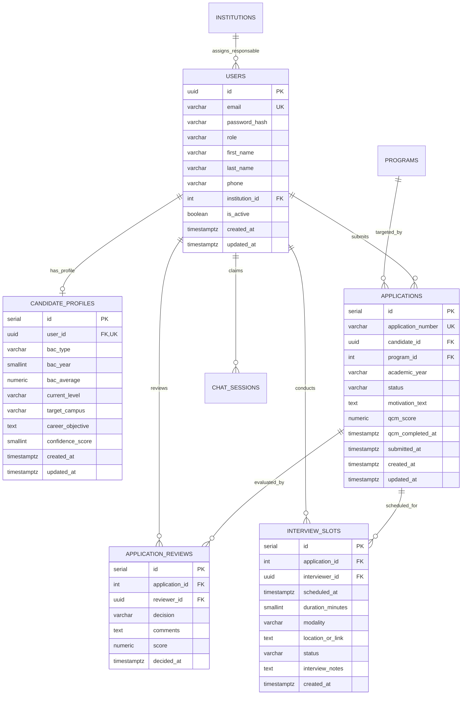
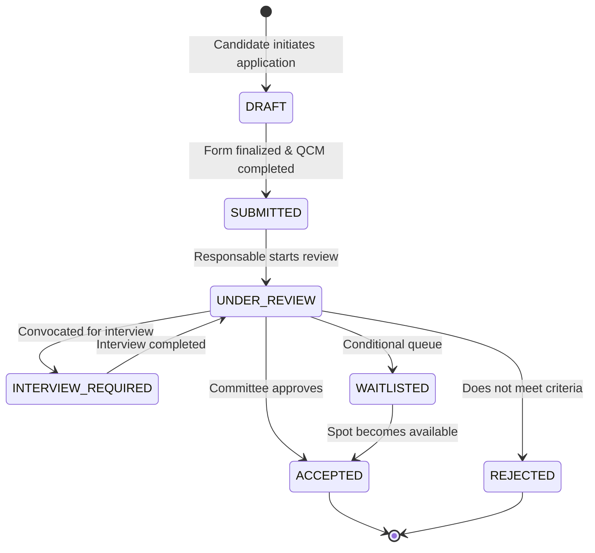

# Users, Candidate Profiles, and Applications Database Guide — V2 (SA-13)

## 1. Purpose & Scope

This data model defines the relational persistence schema for:
1. **User Identity & Role-Based Access Control (RBAC)**: Support for three core roles (`CANDIDAT`, `RESPONSABLE`, `ADMINISTRATEUR`), with institutional segregation for Responsables (IIT vs. ISB).
2. **Progressive Candidate Profiling**: Capturing baccalaureate specialization, average/mention, target institution, and study level gathered during conversation.
3. **Application Lifecycle (Candidatures & Préinscriptions)**: Management of application files (`applications`), program choices, status transitions (`DRAFT`, `SUBMITTED`, `UNDER_REVIEW`, `ACCEPTED`, `REJECTED`), admission QCM scores, and interview slots (`interview_slots`).
4. **Guest Session Claiming (Bridge to SA-29)**: Linking anonymous visitor chat sessions (`chat_sessions`) to registered candidate accounts upon authentication.

This schema works hand-in-hand with the Academic Catalog schema (`V1__catalog.sql`, SA-12) and the Visitor Session schema (`V10__chat_sessions.sql`, SA-25).

---

## 2. Tables at a Glance

| Table | Entity | Description |
|---|---|---|
| `users` | User Account | Central authentication identity with encrypted credentials, role, status, and institution affiliation for Responsables. |
| `candidate_profiles` | Candidate Profile | 1-to-1 extension of `users` for `CANDIDAT` role, storing educational history, Bac details, and study preferences. |
| `applications` | Dossier de Candidature | Represents a formal application submitted by a candidate to a specific program for an academic year. |
| `application_reviews` | Review & Decision | Official evaluations, reviews, and decision notes recorded by academic managers (`RESPONSABLE`). |
| `interview_slots` | Entretien d'Admission | Scheduling and outcome records for candidate admission interviews (online or on campus). |

---

## 3. Relational Architecture & Relationships



---

## 4. Application Status Lifecycle

An application follows a strictly regulated lifecycle ensuring human-in-the-loop validation:



---

## 5. Key Schema Design Decisions

1. **UUIDs for User Accounts**:
   - `users.id` uses `UUIDv4` to match `chat_sessions.id` and prevent sequential ID enumeration attacks.
2. **Institutional Data Segregation**:
   - A user with role `RESPONSABLE` is assigned `institution_id` (pointing to IIT or ISB). Row-level checks and backend policies verify that a Responsable can only read and decide on applications pointing to programs belonging to their institution.
3. **Domain Types & Foreign Key Integrity**:
   - `applications.academic_year` enforces the `academic_year` domain type defined in `V1__catalog.sql` (`YYYY/YYYY`).
   - `applications.program_id` references `programs(id)` with `ON DELETE RESTRICT` to protect academic history from accidental deletion.
4. **Unique Active Application Constraint**:
   - A candidate cannot submit duplicate applications for the same program in the same academic year (`UNIQUE (candidate_id, program_id, academic_year)`).
5. **Bridge to Guest Chat Sessions**:
   - `chat_sessions` is enhanced with `user_id UUID REFERENCES users(id)` and `claimed_at TIMESTAMPTZ`, allowing the seamless link from an anonymous visitor to a registered candidate (SA-29).

---

## 6. Sample Queries

### Find all pending applications for IIT Engineering programs:
```sql
SELECT a.application_number, u.first_name, u.last_name, p.name_fr AS program_name,
       cp.bac_type, cp.bac_average, a.qcm_score, a.submitted_at
FROM applications a
JOIN users u ON u.id = a.candidate_id
JOIN candidate_profiles cp ON cp.user_id = u.id
JOIN programs p ON p.id = a.program_id
JOIN institutions i ON i.id = p.institution_id
WHERE i.code = 'IIT' AND a.status = 'SUBMITTED'
ORDER BY a.submitted_at ASC;
```

### Claim an anonymous guest conversation for a newly registered candidate:
```sql
UPDATE chat_sessions
SET user_id = :candidate_user_id,
    claimed_at = now()
WHERE id = :session_id AND user_id IS NULL;
```
