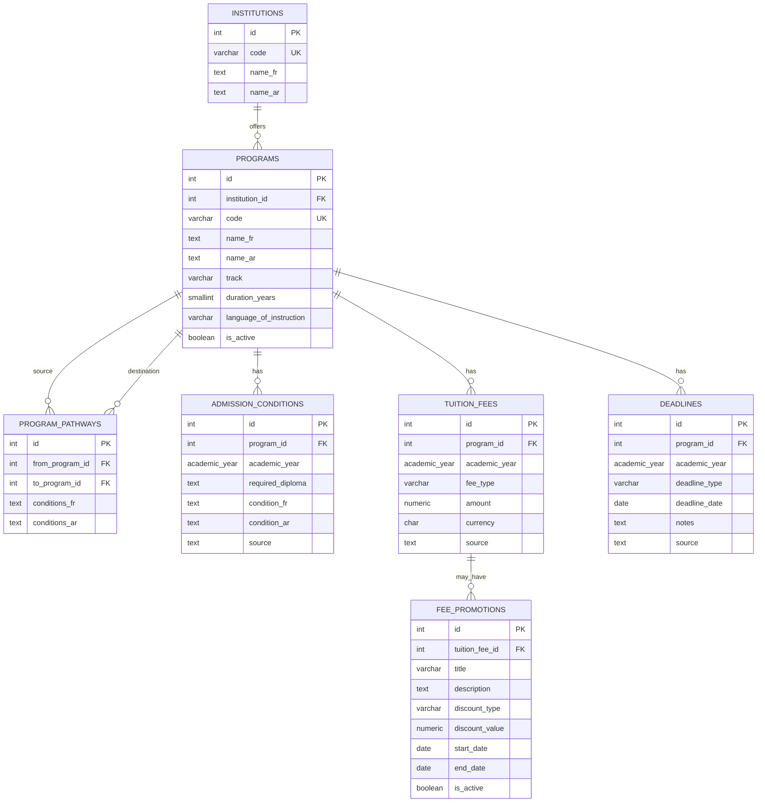

# Academic Catalog Database — V1 (SA-12)

## 1. Purpose

This schema stores the academic catalog: institutions, the programs they offer, admission requirements, tuition fees, important dates, pathways between programs, and temporary fee promotions.

The central table is **`programs`**. Most catalog information is attached to a program through its `id`.

## 2. Tables at a glance

| Table | Purpose |
|---|---|
| `institutions` | Universities, institutes, and other educational institutions. |
| `programs` | Academic programs offered by institutions, with their language and study details. |
| `program_pathways` | Possible transitions from one program to another. |
| `admission_conditions` | Admission requirements for a program in a given academic year. |
| `tuition_fees` | Fees charged for a program in a given academic year. |
| `deadlines` | Important dates in a program's application and admission process. |
| `fee_promotions` | Time-limited discounts applied to a specific tuition-fee record. |

## 3. Relationships

**Cardinality key:**
- `||` means exactly one.
- `o{` means zero or many.
- For example, one institution can offer many programs, while each program belongs to one institution.

## 4. Table details and examples

The examples below are illustrative. They are not real institutional fee or admission data.

### 4.1 `institutions`

Stores each institution once.

| id | code | name_fr | name_ar |
|---:|---|---|---|
| 1 | IIT | Institut International de Technologie | المعهد الدولي للتكنولوجيا |
| 2 | ISB |  École Internationale Supérieure Privée des Affaires de Sfax | المدرسة الدولية العليا الخاصة للأعمال بصفاقس |

- `id` is the primary key.
- `code` is unique, so two institutions cannot share the same code.
- `name_ar` is optional.

### 4.2 `programs`

Stores the programs offered by institutions. Each program row represents **one language of instruction**.

| id | institution_id | code | name_fr / name | track | duration_years | language_of_instruction |
|---:|---:|---|---|---|---:|---|
| 1 | 1 | GL-FR | Génie Logiciel | INGENIEUR | 3 | FR |
| 2 | 1 | GL-EN | Software Engineering | INGENIEUR | 3 | EN |
| 3 | 2 | INFO-FR | Informatique | LICENCE | 3 | FR |

If the same program is taught in French and English, store two rows (one per language), with distinct codes such as `GL-FR` and `GL-EN`. This lets fees, conditions, and deadlines point directly to the relevant language-specific program row.

Important constraints:
- `institution_id` references `institutions.id`.
- `code` is unique.
- `track` must be one of `LICENCE`, `PREPA`, `INGENIEUR`, or `AUTRE`.
- `language_of_instruction` must be `FR` or `EN`.
- `duration_years`, when supplied, must be between 1 and 8.
- `is_active` defaults to `TRUE`.

### 4.3 `program_pathways`

Represents a possible transition from one program to another. Both foreign keys reference `programs`.

| id | from_program_id | to_program_id | conditions_fr |
|---:|---:|---:|---|
| 1 | 3 | 1 | Admission sur dossier |
| 2 | 1 | 4 | Validation des prérequis |

- `from_program_id` is the starting program.
- `to_program_id` is the destination program.
- A program cannot point to itself.
- The same ordered pair (`from_program_id`, `to_program_id`) cannot be duplicated.
- `ON DELETE CASCADE` means deleting either referenced program deletes the corresponding pathway row.

### 4.4 `admission_conditions`

Stores the admission rules for a program and academic year. A program may have different requirements in different years.

| id | program_id | academic_year | required_diploma | condition_fr |
|---:|---:|---|---|---|
| 1 | 1 | 2026/2027 | Licence | Étude du dossier |
| 2 | 1 | 2027/2028 | Licence | Concours d'admission |
| 3 | 2 | 2026/2027 | Bachelor's degree | Application review |

- `program_id` references `programs.id`.
- `academic_year` uses the custom `academic_year` domain described below.
- `condition_fr` and `source` are required.
- `ON DELETE CASCADE` removes these records if their program is deleted.

### 4.5 `tuition_fees`

Stores fee amounts by program, academic year, and fee type.

| id | program_id | academic_year | fee_type | amount | currency |
|---:|---:|---|---|---:|---|
| 1 | 1 | 2026/2027 | ANNUEL | 3500.00 | TND |
| 2 | 1 | 2026/2027 | INSCRIPTION | 150.00 | TND |
| 3 | 2 | 2026/2027 | ANNUEL | 4000.00 | TND |
| 4 | 2 | 2026/2027 | SEMESTRIEL | 2200.00 | TND |

Allowed `fee_type` values:
- `INSCRIPTION`
- `ANNUEL`
- `SEMESTRIEL`
- `DOSSIER`

The combination of `program_id`, `academic_year`, and `fee_type` must be unique. Therefore, one program cannot have two `ANNUEL` fee rows for the same academic year.

`amount` cannot be negative. `currency` defaults to `TND`.

### 4.6 `deadlines`

Stores dates for steps in the admission process. One program can have several deadline types in an academic year.

| id | program_id | academic_year | deadline_type | deadline_date |
|---:|---:|---|---|---|
| 1 | 1 | 2026/2027 | DEPOT_DOSSIER | 2026-07-15 |
| 2 | 1 | 2026/2027 | CONCOURS | 2026-08-01 |
| 3 | 1 | 2026/2027 | RESULTATS | 2026-08-20 |
| 4 | 1 | 2026/2027 | INSCRIPTION | 2026-09-05 |

Allowed `deadline_type` values:
- `DEPOT_DOSSIER`
- `CONCOURS`
- `ENTRETIEN`
- `RESULTATS`
- `INSCRIPTION`

The combination of `program_id`, `academic_year`, and `deadline_type` must be unique. A deadline requires a date and a source; `notes` is optional.

**Why keep deadlines in a separate table?** A program can have multiple dates (application submission, exam, interview, results, registration), and those dates can change from one academic year to another. A separate table allows each date to be stored and updated independently.

### 4.7 `fee_promotions` (implemented table)

A promotion is linked to a **specific row in `tuition_fees`**, not directly to `programs`.

This is intentional: `tuition_fees` already identifies the program, academic year, fee type, amount, and currency. Referencing `tuition_fees.id` avoids repeating `program_id` or `fee_type` in the promotion table.

Example data:

| id | tuition_fee_id | title | discount_type | discount_value | start_date | end_date | is_active |
|---:|---:|---|---|---:|---|---|---|
| 1 | 1 | Early Bird | PERCENTAGE | 15.00 | 2026-06-01 | 2026-06-30 | TRUE |
| 2 | 1 | Summer Offer | PERCENTAGE | 10.00 | 2026-07-01 | 2026-07-15 | TRUE |
| 3 | 2 | Registration Discount | PERCENTAGE | 20.00 | 2026-06-01 | 2026-06-15 | TRUE |
| 4 | 3 | Special Offer | FIXED | 500.00 | 2026-08-01 | 2026-08-20 | TRUE |

For example, promotion 1 references tuition fee 1 (3,500 TND annual fee). A 15% discount is 525 TND, making the discounted amount 2,975 TND, if the promotion's conditions are met.

`discount_type` determines how to interpret `discount_value`:
- `PERCENTAGE`: the value is a percentage, such as `15` for 15%.
- `FIXED`: the value is a fixed amount in the fee's currency, such as `500` TND.

 
The current table includes `is_active` as a manual enable/disable flag. The application should also check the dates; `is_active = TRUE` alone does not mean the promotion is currently valid.

## 5. Shared SQL conventions and database behavior

### Academic-year domain

The SQL defines a reusable domain:

academic_year: 
Valid example: `2026/2027`.

Invalid examples: `2026-2027`, `2026/2028`, `26/2027`.

This domain is used by `admission_conditions`, `tuition_fees`, and `deadlines`.

### `updated_at` trigger

The `set_updated_at()` function sets `NEW.updated_at = now()` before every update to a `programs` row. The trigger is attached to `programs` only.

### Foreign-key deletion behavior

The child tables `program_pathways`, `admission_conditions`, `tuition_fees`, and `deadlines` use `ON DELETE CASCADE` on their program references. Deleting a program therefore deletes its dependent records. In the proposed promotions table, deleting a tuition-fee row also deletes its promotions.

Use cascade deletion carefully: it is appropriate only if the team wants dependent catalog data removed with the parent record.

### Indexes in the original V1 SQL

The migration creates these indexes:idx_programs_institution, idx_conditions_program_year, idx_fees_program_year, idx_deadlines_program_year, idx_fee_promotions_tuition_fee_id.

The `fee_promotions` table adds an index on `tuition_fee_id` to speed up fetching promotions for a fee.

Primary keys and unique constraints also create their own supporting indexes in PostgreSQL. PostgreSQL does **not** automatically create an index on the referencing side of a foreign key.

## 6. Quick glossary

| Term | Meaning |
|---|---|
| PK (Primary Key) | Uniquely identifies a row in a table. |
| FK (Foreign Key) | References a row in another table and enforces the relationship. |
| UNIQUE | Prevents duplicate values or duplicate combinations. |
| CHECK | Restricts values to satisfy a condition. |
| NOT NULL | Requires a value. |
| DEFAULT | Supplies a value when one is not explicitly provided. |
| CASCADE | Automatically deletes dependent rows when the referenced parent row is deleted. |
| Index | Helps PostgreSQL find rows more efficiently for suitable queries. |

## 7. Summary

- `institutions` identifies who offers programs.
- `programs` stores each program-language offering.
- `program_pathways` connects a starting program to a destination program.
- `admission_conditions` stores year-specific admission rules.
- `tuition_fees` stores year-specific fees.
- `deadlines` stores year-specific admission dates.

The main data path is:

`institutions → programs → tuition_fees → fee_promotions`

Admission conditions and deadlines are separate children of `programs`.
