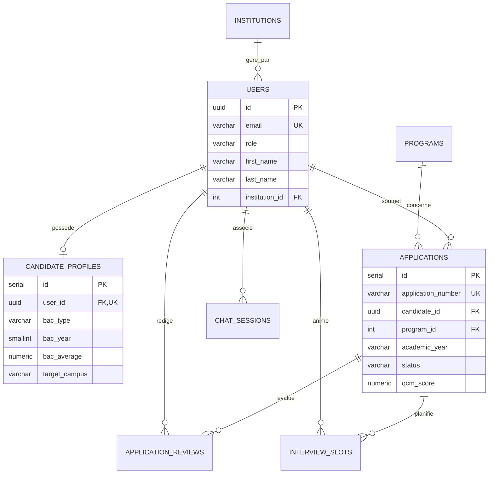

# Rapport de Réalisation : SA-13

| Métadonnée | Valeur |
|---|---|
| **Identifiant Tâche** | **SA-13** |
| **Titre** | **Concevoir les tables des utilisateurs et des candidatures** |
| **Assignée à** | **EK (Erij Kacem)** |
| **Sprint** | Sprint 1 — Socle Technique |
| **Epic** | SA-10 : Données relationnelles et référentiels |
| **Story** | SA-11 : Modèle relationnel métier |
| **Statut** | **DONE (Prêt pour Revue)** |

---

## 1. Contexte & Objectif

Dans le cadre du portail d'admission et du conseiller conversationnel SmartCampus AI (IIT & ISB), la tâche **SA-13** consiste à concevoir le modèle relationnel complet pour :
1. **Les Utilisateurs & Rôles (RBAC)** : Gérer les comptes des candidats (`CANDIDAT`), des responsables pédagogiques (`RESPONSABLE` rattachés soit à l'IIT, soit à l'ISB) et des administrateurs (`ADMINISTRATEUR`).
2. **Le Profil Académique Progressif** : Structurer les données de profilage candidat (Baccalauréat, moyenne, année, série, campus visé, score de confiance) issues des échanges avec l'agent IA.
3. **Le Dossier de Candidature (Applications)** : Modéliser le cycle de vie complet de la candidature (soumission, préinscription, QCM d'admission, entretien et décision d'admission).
4. **La Passerelle Visiteur-Candidat (Pont SA-29)** : Prévoir la liaison native entre la session de chat invité (`chat_sessions`) et le compte candidat une fois créé.

---

## 2. Architecture & Diagramme Entité-Association (ERD)

---

## 3. Détail des Entités & Règles Métier Définies

1. **Table `users`** :
   - Clé primaire en `UUIDv4` sécurisé pour éviter l'énumération d'identifiants.
   - Contrainte `role IN ('CANDIDAT', 'RESPONSABLE', 'ADMINISTRATEUR')`.
   - Clé étrangère conditionnelle `institution_id REFERENCES institutions(id)` assurant l'isolation institutionnelle (un Responsable IIT ne peut consulter que les dossiers IIT).

2. **Table `candidate_profiles`** :
   - Relation 1-to-1 avec `users` (`UNIQUE (user_id)`).
   - Informations conformes au formulaire frontend développé en **SA-8** (`RegistrationModal.tsx` & `ProfileDrawer.tsx`) : série du Bac, moyenne (0-20), année de graduation, filière d'intérêt et indice de complétude du profil.

3. **Table `applications`** :
   - Numéro unique de dossier `application_number` (ex. `APP-2026-IIT-0042`).
   - Statuts stricts : `DRAFT`, `SUBMITTED`, `UNDER_REVIEW`, `ACCEPTED`, `REJECTED`, `WAITLISTED`, `CANCELLED`.
   - Score au QCM d'évaluation académique (0 à 100) et horodatage de validation.
   - Contrainte d'unicité `UNIQUE (candidate_id, program_id, academic_year)` interdisant les doublons pour la même rentrée.

4. **Table `application_reviews` & `interview_slots`** :
   - Traçabilité des évaluations humaines obligatoires (note sur 20, avis, motif).
   - Gestion des entretiens oraux (en ligne ou en présentiel).

---

## 4. Livrables Associés

- **Guide de référence détaillé** : [users_and_applications_guide.md](file:///c:/Users/MSI/Documents/projectIA/backend/bd/docs/users_and_applications_guide.md)
- **Script SQL de migration (SA-17)** : [V2__users_and_applications.sql](file:///c:/Users/MSI/Documents/projectIA/backend/bd/migrations/V2__users_and_applications.sql)
